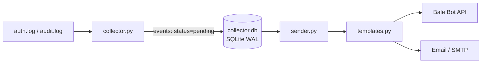

<div align="center">

# ssh-alarm-trigger

**Real-time SSH login alerts via Bale Messenger and Email**
**هشدار لحظه‌ای ورود SSH از طریق پیام‌رسان بله و ایمیل**


</div>

---

<div dir="rtl">

## 🇮🇷 معرفی (فارسی)

**ssh-alarm-trigger** یک سیستم سبک و دو‌بخشی برای سرورهای لینوکسی است که لاگ‌های ورود SSH را می‌خواند و **ورودهای موفق و ناموفق** را همان لحظه از دو مسیر به شما اطلاع می‌دهد:

- پیام‌رسان **بله** (Bot API)
- **ایمیل** (SMTP، با قالب HTML زیبا و ریسپانسیو)

فقط از کتابخانه استاندارد پایتون استفاده می‌شود و **هیچ وابستگی خارجی‌ای نیاز نیست**.

### ویژگی‌ها

- خواندن `auth.log` / `secure` و همچنین `audit.log` (بدون هشدار تکراری)
- ذخیره رویدادها در SQLite و ارسال مستقل توسط پروسه‌ی دوم
- ریستارت سرویس باعث ارسال دوباره‌ی تاریخچه نمی‌شود
- اگر یکی از کانال‌ها (بله یا ایمیل) خطا بدهد، فقط همان کانال دوباره تلاش می‌شود
- منطقه‌ی زمانی نمایش قابل تنظیم است (مثلاً `Asia/Tehran`)

### برای راه‌اندازی چه کارهایی باید انجام دهید؟

1. پروژه را روی سرور کلون کنید (پیشنهاد: `/opt/ssh-alarm-trigger`).
2. یک **ربات در بله** بسازید و **توکن** و **chat_id** را بردارید.
3. فایل‌های نمونه را به `config.json` و `sender_config.json` کپی و مقادیر را پر کنید.
4. اگر ایمیل می‌خواهید، اطلاعات SMTP را وارد کنید و رمز را با متغیر محیطی `SMTP_PASSWORD` بدهید.
5. دسترسی فایل تنظیمات را محدود کنید: `chmod 600 sender_config.json`
6. فایل‌های سرویس را در `systemd` نصب و فعال کنید.
7. تست کنید: یک ورود (موفق یا ناموفق) SSH انجام دهید و پیام را دریافت کنید.

جزئیات دستورها در بخش انگلیسیِ پایین آمده است.

### شفافیت درباره‌ی توسعه

این پروژه **توسط Claude (هوش مصنوعی Anthropic) طراحی و نوشته شده است**؛ تمام کد را Claude تولید کرده است.
نقش سازنده‌ی ریپو (**soli-47**): ارائه‌ی ایده و نظریه، تعریف نیازمندی‌ها، **تست** و **کنترل** نتیجه.
پیشنهاد می‌شود پیش از استفاده در محیط production، کد را خودتان هم بررسی و تست کنید.

</div>

---

## Table of Contents

- [Features](#features)
- [Architecture](#architecture)
- [Requirements](#requirements)
- [Installation & Setup](#installation--setup)
- [Configuration](#configuration)
- [Running with systemd](#running-with-systemd)
- [How it works](#how-it-works)
- [Message preview](#message-preview)
- [Database](#database)
- [Troubleshooting](#troubleshooting)
- [Security notes](#security-notes)
- [Limitations](#limitations)
- [Roadmap](#roadmap)
- [Development notes](#development-notes)
- [License](#license)

## Features

- Detects **successful** and **failed** SSH logins in real time.
- Sends alerts to **Bale** (Bot API, `/sendMessage`) and **Email** (SMTP, optional STARTTLS).
- Python standard library only, no `pip install` required.
- Two independent processes communicating through SQLite (WAL mode).
- Reads `auth.log` / `secure` or `audit.log` (audit takes priority to avoid duplicate alerts).
- No history replay after a restart.
- Per-channel delivery tracking: a failing channel never blocks the other one.
- HTML email card (inline styles, Gmail/Outlook/mobile friendly) and short plain-text Bale message.
- Configurable display timezone.

## Architecture



| File | Role |
|---|---|
| `collector.py` | Reads logs, filters with regex, stores events in SQLite |
| `sender.py` | Reads pending events and delivers them to Bale and Email |
| `templates.py` | Parses log lines and builds messages (plain text for Bale, HTML for email) |
| `config.json.example` | Collector config template |
| `sender_config.json.example` | Sender config template (token / SMTP) |
| `service/*.service` | systemd unit files |

## Requirements

- Linux with Python **3.9+**
- Read access to the log files (root, or membership in the `adm` group for `/var/log/auth.log`; `audit.log` usually requires root)
- A Bale bot token and chat ID (for Bale alerts)
- An SMTP server (for email alerts, optional)

## Installation & Setup

> **What you need to do, in short:** clone → create Bale bot → copy & edit configs → set SMTP password → install services → test.

**1. Clone the project**

```bash
sudo git clone https://github.com/soli-47/ssh-alarm-trigger.git /opt/ssh-alarm-trigger
cd /opt/ssh-alarm-trigger
```

**2. Create a Bale bot**

Create a bot in Bale and note its **token** and the **chat ID** that should receive alerts.

**3. Create your config files from the templates**

```bash
sudo cp config.json.example config.json
sudo cp sender_config.json.example sender_config.json
sudo chmod 600 sender_config.json
sudo nano sender_config.json
```

Replace every `YOUR_...` placeholder with your real values (see [Configuration](#configuration)).

**4. Set the SMTP password (recommended: environment variable)**

Do not store the password in the file. Provide it through `SMTP_PASSWORD` (see the systemd step below). It takes priority over the value in `sender_config.json`.

**5. Install and start the services**

See [Running with systemd](#running-with-systemd).

**6. Test**

From another machine, try an SSH login (successful or with a wrong password) and check that the alert arrives.

```bash
sudo journalctl -u log-collector -u log-sender -f
```

## Configuration

Real config files (`config.json`, `sender_config.json`) are listed in `.gitignore` and must **never** be committed.

### `config.json` (collector)

| Key | Description | Example |
|---|---|---|
| `log_paths` | Log files to read. A path containing `audit` is treated as auditd log, others as auth log | `["/var/log/auth.log", "/var/log/audit/audit.log"]` |
| `database` | SQLite database path (shared with sender) | `collector.db` |
| `log_file` | Collector's own log file | `collector.log` |
| `poll_interval` | Seconds between reads | `3` |
| `start_at_end` | For a file seen for the first time, start at its end | `true` |
| `skip_backlog_on_start` | On startup, jump to the end of all files (ignore old/downtime logs) | `true` |

```json
{
  "log_paths": ["/var/log/auth.log", "/var/log/audit/audit.log"],
  "database": "collector.db",
  "log_file": "collector.log",
  "poll_interval": 3,
  "start_at_end": true,
  "skip_backlog_on_start": true
}
```

### `sender_config.json` (sender)

| Key | Description | Example |
|---|---|---|
| `database` | Same database as the collector | `collector.db` |
| `bot_api_base` | Bale Bot API base URL (HTTPS only) | `https://tapi.bale.ai/bot<TOKEN>/` |
| `chat_id` | Target chat ID | `<CHAT_ID>` |
| `poll_interval` | Seconds between checks for pending events | `5` |
| `batch_size` | Events processed per cycle | `10` |
| `timeout` | Network timeout in seconds | `10` |
| `display_timezone` | Timezone used in messages | `Asia/Tehran` |
| `server_ip` | Server IP shown in messages; empty = auto-detect | `""` |
| `email.enabled` | Enable email channel | `true` |
| `email.smtp_host` | SMTP server | `smtp.example.com` |
| `email.smtp_port` | SMTP port | `25` |
| `email.use_tls` | Use STARTTLS | `true` |
| `email.sender` | From address | `alerts@example.com` |
| `email.recipient` | To address | `admin@example.com` |
| `email.username` | SMTP username | `alerts@example.com` |
| `email.password` | SMTP password (prefer `SMTP_PASSWORD` env var) | *(leave empty)* |

```json
{
  "database": "collector.db",
  "bot_api_base": "https://tapi.bale.ai/bot<TOKEN>/",
  "chat_id": "<CHAT_ID>",
  "poll_interval": 5,
  "batch_size": 10,
  "timeout": 10,
  "display_timezone": "Asia/Tehran",
  "server_ip": "",
  "email": {
    "enabled": true,
    "smtp_host": "smtp.example.com",
    "smtp_port": 25,
    "use_tls": true,
    "sender": "alerts@example.com",
    "recipient": "admin@example.com",
    "username": "alerts@example.com"
  }
}
```

## Running with systemd

**Manual run (for testing):**

```bash
sudo python3 collector.py
sudo SMTP_PASSWORD='your-password' python3 sender.py
```

**Install services:**

```bash
sudo cp service/log-collector.service /etc/systemd/system/
sudo cp service/log-sender.service /etc/systemd/system/
```

Make sure `WorkingDirectory` and `ExecStart` in both files point to your install path (`/opt/ssh-alarm-trigger` in this guide).

**Provide the SMTP password to the sender service:**

```bash
sudo systemctl edit log-sender
```

```ini
[Service]
Environment="SMTP_PASSWORD=your-password"
```

**Enable and start:**

```bash
sudo systemctl daemon-reload
sudo systemctl enable --now log-collector log-sender
sudo systemctl status log-collector log-sender
```

**Example unit file (`log-collector.service`):**

```ini
[Unit]
Description=Log Collector
After=network.target

[Service]
Type=simple
User=root
WorkingDirectory=/opt/ssh-alarm-trigger
ExecStart=/usr/bin/python3 /opt/ssh-alarm-trigger/collector.py
Restart=always
RestartSec=5
StartLimitIntervalSec=60
StartLimitBurst=10

[Install]
WantedBy=multi-user.target
```

`log-sender.service` is identical except for `Description=Log Event Sender`, `After=network.target log-collector.service`, `Wants=log-collector.service` and `ExecStart=... sender.py`.

## How it works

**Collector**

- Picks the log type by real file availability: a path containing `audit` is parsed as auditd (`USER_AUTH` / `USER_LOGIN` with `exe` = `sshd` or `sshd-session`, `res=success|failed`); other paths as auth log (`Failed password`, `Accepted password|publickey|keyboard-interactive`).
- If a readable audit log exists, **only audit is used** and auth paths are ignored (prevents duplicate alerts). If audit is missing or unreadable, it falls back to the auth log with a warning. If no usable source exists, it stops with a clear error.
- Per-file read offsets are stored in `file_offsets`. Events and offsets are committed in **one transaction**. Only complete lines (ending with `\n`) are processed.
- If a file becomes smaller than its offset (truncate/rotate), it is read from the beginning.
- Duplicate protection: `event_hash` = SHA-256 of (source + message), `UNIQUE` + `INSERT OR IGNORE`.

**Sender**

- On start, `started_at` is recorded. Pending events older than it are marked `skipped` and never sent (compared with `julianday`, safe against timezone issues).
- Delivery is tracked per channel (`bale_sent`, `email_sent`, auto-migrated). Only the failed channel is retried. When all enabled channels succeed, status becomes `sent`.
- Bale: `POST <bot_api_base>/sendMessage`, HTTPS only; success requires a JSON response with `ok=true`.
- Email: SMTP with optional STARTTLS, multipart (plain text + HTML).
- Server IP comes from `server_ip` or is detected through a UDP socket (no packet is sent).

## Message preview

- **Bale:** short text with emojis: user, source, method, server, time, short event ID.
- **Email:** HTML card with a colored header (green = success, red = failed), details table, raw log block and footer. Subject example: `🔴 Failed SSH login attempt — admin@hostname`.
- Time is taken from the log line when readable, otherwise from `occurred_at`.

## Database

SQLite (WAL mode), shared by both processes.

| Table | Purpose |
|---|---|
| `events` | Detected events: type (`ssh_failed` / `ssh_success`), `status` (`pending` / `sent` / `skipped`), `occurred_at`, `event_hash` (unique), `bale_sent`, `email_sent` |
| `file_offsets` | Last read position per log file |

## Troubleshooting

| Problem | What to check |
|---|---|
| `Permission denied` on a log file | Run as root or add the user to the `adm` group; `audit.log` usually needs root |
| Audit file not found | Install/enable `auditd`, or rely on the auth log (collector falls back with a warning) |
| No messages arrive | Check `journalctl -u log-sender`, the Bale token/chat ID, outbound HTTPS access, and the `collector.log` / `sender.log` files |
| No email | Verify `email.enabled`, SMTP host/port/TLS, and that `SMTP_PASSWORD` is set for the service |
| Old events never sent | Intended: events created before the sender started are skipped |

## Security notes

- **Never commit** the Bale token or SMTP password. Use `SMTP_PASSWORD` and keep `config.json`, `sender_config.json`, `*.db` and `*.log` in `.gitignore`.
- Run `chmod 600 sender_config.json`.
- Logs contain **IP addresses and usernames** and are sent to external services (Bale, email provider). Consider the privacy implications.
- Services run as root by default so they can read `audit.log`; if you only use `auth.log`, a less privileged user in the `adm` group may be enough.

## Limitations

- Only SSH login events are supported.
- Log rotation is detected by file size only (not inode).
- Events created while the sender is down are intentionally not sent.
- A single successful login may produce several records in audit.
- No aggregation or rate-limiting for brute-force attacks yet.
- The `Method` field in audit is derived from the terminal and is less precise than in auth.log.

## Roadmap

- Log rotation detection by inode
- GeoIP for source IPs
- Brute-force alert aggregation
- More channels (Telegram, Slack)
- Unit tests

## Development notes

This project was **designed and written by Claude** (an AI assistant by Anthropic); all code was generated by Claude. The repository owner (**soli-47**) provided the idea and theory, defined the requirements, and acted as **tester and reviewer**.

Please review and test the code yourself before using it in production.

## License

`<TODO: choose a license, e.g. MIT>`
